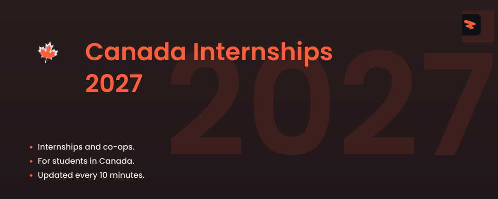

<!-- Cover -->

# Canada Internships 2027

🚀 Internships and co-ops across tech, business, healthcare, and more for students in Canada, sourced live and updated every 10 minutes.

  
  
  
  

---

## **Website & Autofill Extension**

Explore Zapply's website and check out:

- Our Chrome extension, which autofills job applications in seconds.
- A dedicated job board featuring the latest openings across various roles.
- User accounts with multiple profiles for different resume types and roles.
- Job application tracking with streaks and commitment awards.

Experience an advanced career journey with us! 🚀

  

## Explore Around

Connect and seek advice from a growing network of fellow students and new grads.

  
  &nbsp;&nbsp;
  

---

 

<h3>💻 <strong>Software Engineering</strong></h3>

| Company | Role | Location | Posted | Visa | **Apply** |
|---------|------|----------|--------|------|----------|
| **Capital One** | Associate, Software Engineer, New Grad Card Expansion | Toronto, ON | 54m |  |  |
| **Cisco** | Software Developer Embedded Systems I (Full Time) - Canada | Kanata Ontario Canada +5 more | 1h |  |  |
| **Rivian and Volkswagen Group Technologies** | Software Engineering Intern - Vehicle Controls (January - August 2027) | Vancouver, BC | 4h |  |  |
| **Geotab** | Vehicle Systems Engineering | Waterloo | 5h |  |  |
| **1Password** | Junior Security Engineer | Remote | 6h |  |  |
| **TD Bank** | Guidewire Software Engineer I | Toronto | 1d |  |  |
| **BMO** | Junior Cloud Engineer, Summer 2027 (Co-op/Internship) - 16 months | Toronto, ON | 1d |  |  |
| **CIBC** | Application/Software Developer Co-op (Winter 2027), Enterprise Technology & Business Management | Toronto, ON | 1d |  |  |
| **CIBC** | Application/Software Developer Co-op (Winter 2027), Capital Markets Technology | Toronto, ON | 1d |  |  |
| **Altera** | Software Engineer -  Intern | Toronto | 4d |  |  |
| **Cisco** | Software Developer Full Stack / Backend I (Co-op) - Canada | Kanata Ontario Canada +7 more | 4d |  |  |
| **Cisco** | Software Developer Embedded Systems II (Co-op) – Canada | Kanata Ontario Canada +6 more | 4d |  |  |
| **TD Bank** | TD Asset Management Portfolio Analytics Developer Intern/Co-Op (Winter 2027) | 161 Bay Street Corporate | 4d |  |  |
| **Affirm** | Software Engineer I, Fullstack (Search) | Canada | 5d |  |  |
| **Nokia** | Embedded C/C++ SW Developer Co-op/Intern | Canada | 5d | ✅ Sponsor |  |
| **Pebl** | Software Engineering, Intern | Toronto, ON | 6d |  |  |
| **Aptiv** | Software Engineering Intern | CAN Kanata (2), ON | 1w |  |  |
| **Aptiv** | Cloud Engineering Intern | CAN Kanata (2), ON | 1w |  |  |
| **Aptiv** | Cloud Engineer Intern | CAN Kanata (2), ON | 1w |  |  |
| **Manulife** | Winter Co-op 2027 - Software Engineering | Toronto | 1w |  |  |
| **Ecolab** | Junior Quality Control Software Developer | Calgary | 1w |  |  |
| **TD Bank** | Software Engineer I - Front End | Toronto | 1w |  |  |
| **General Motors** | Early Career Software Test Developer - Propulsion Thermal Management | Markham | 1w |  |  |
| **Motorola Solutions** | Software Developer, Embedded Appliances Co-Op | Vancouver | 1w |  |  |
| **Capital One** | Associate, Software Engineer, New Grad | Toronto, ON | 1w |  |  |
| **Lumentum** | Embedded Software Engineer Co-op/Intern | Canada - Ottawa | 2w |  |  |
| **General Motors** | 2027 Winter Co-op Vehicle Experience Software Developer | Markham | 2w |  |  |
| **Capital One** | Intern, Full Stack Software Engineer - Summer 2027 | Toronto, ON | 2w |  |  |
| **Lumentum** | Embedded Software Developer Co-op (Optical Circuit Switch) | Canada - Ottawa | 2w |  |  |
| **Semtech** | Software Developer – Web/Cloud Application, Co-op | CAN - Richmond, BC | 2w |  |  |
| **Google** | Software Developer Intern, PhD, Summer 2027 | Canada | Date unknown |  |  |
| **Pinterest** | Software Engineering Intern 2027 (Toronto) | Toronto, ON | 2w |  |  |
| **General Motors** | 2027 Winter Co-op Data Engineering Software Developer | Markham Ontario Canada +1 more | 2w |  |  |
| **RTX** | Stage - Hiver 2027 - Service Numériques pour les Moteurs – Développeur logiciel/ Internship -... | Qc, CA | 3w |  |  |
| **RTX** | Internship - Winter 2027 - Software Developer Aerospace Control Systems & Web Applications | On, CA | 3w |  |  |
| **Lyft** | Business Systems Engineer Intern, Finance Technology (Summer 2027) | Toronto | 3w |  |  |
| **Kent Building Supplies** | Security Analyst Student - Winter 2027 | Saint John, NB | 3w |  |  |
| **BMO** | Quantitative Developer (Alpha Research Team) - GAM, Summer 2027 (Co-op/Internship) - 12 months | Toronto, ON | 4w |  |  |
| **RTX** | Stage - Hiver 2027 - Soutien aux equipes HEP (hybrid-electric propulsion) Soutien aux... | Qc, CA | 1mo |  |  |
| **Magnet Forensics** | Software Developer Co-op (Winter 2027) | Waterloo / Ottawa / Ontario | 1mo |  |  |
| **Manulife** | Summer Intern 2027 - Software Engineering (12 Months) | Waterloo | 1mo |  |  |
| **Kent Building Supplies** | Combat Systems Engineering Student/Co-op- Winter 2027 | Dartmouth, NS | 1mo |  |  |
| **Stripe** | Software Engineer, Early Career — Immediate Start | Toronto | 1mo | ✅ Sponsor |  |
| **Tower Research Capital** | Stagiaire en développement de logiciels (été 2027) / Software Developer Intern (Summer 2027) | Montreal | 1mo | ✅ Sponsor |  |
| **Qualcomm** | FY27 Intern - Low-Power AI, Audio, and Sensors Subsystem Engineering Internship - ASIC Firmware... | Markham | 1mo |  |  |
| **Qualcomm** | FY27 Intern - Firmware/Embedded Software Engineering Internship - Canada (12 or 16 months) | Toronto | 1mo |  |  |
| **Affirm** | Software Engineer I, Frontend (Upfunnel) | Canada | 1mo |  |  |
| **Lyft** | Software Engineer Intern, Machine Learning (Summer 2027 - Toronto) | Toronto | 1mo |  |  |
| **Lyft** | Software Engineer Intern, Backend (Summer 2027 - Montreal) | Montreal | 1mo |  |  |
| **BMO** | Cloud Business & Strategy Analytics Analyst, Winter 2027 (Co-op/Internship) - 4 Months | Toronto, ON | 1mo |  |  |
| **Manulife** | Summer Intern 2027 - Software Engineering (8 Months) | Toronto | 1mo |  |  |
| **Rivian and Volkswagen Group Technologies** | Software Engineering Intern - Applications, Infotainment & Mobile (January - August 2027) | Vancouver, BC +1 more | 1mo |  |  |
| **Stripe** | Software Engineer, Intern (Summer or Winter) | Toronto | 1mo | ✅ Sponsor |  |
| **Stripe** | Software Engineer, New Grad | Toronto | 1mo | ✅ Sponsor |  |
| **Thales** | CO-OP Systems Engineer- Vancouver shipyard | British Columbia Remote | 2mo |  |  |
| **Fullscript** | Software Developer (Co-op Opportunities) | Ottawa, ON | 3mo | ✅ Sponsor |  |
| **DRW** | Software Developer Intern | Montreal | 3mo |  |  |
| **TribalScale** | Agile Software Engineer - Co-op | Toronto, ON | 4mo |  |  |
| **Squarepoint Capital** | Intern Software Developer - Montreal - 2027 | Montreal | 5mo |  |  |
| **Cresta** | Software Engineer Intern | Toronto Canada | 25mo |  |  |
| **Databricks** | Software Engineering Intern (2027) | Bellevue +3 more | 39mo |  |  |

Apply for more jobs at

<h3>⚙️ <strong>Hardware & Systems</strong></h3>

| Company | Role | Location | Posted | Visa | **Apply** |
|---------|------|----------|--------|------|----------|
| **NVIDIA** | ASIC Verification Intern - Summer 2027 | Canada | 1d |  |  |
| **Stantec** | Electrical Engineering Intern – Buildings (Winter 2027) - 8 Month Term | Edmonton, AB | 5d | ✅ Sponsor |  |
| **Lumentum** | Electrical Engineer Co-op/Intern | Canada - Ottawa | 6d |  |  |
| **Hitachi** | Stagiaire Génie Électrique et Contrôle / Electrical and Controls Engineering Intern | Varennes | 1w |  |  |
| **Stantec** | Electrical Engineering Intern (EIT) - Industrial Electrical | Montreal, QC | 1w | ✅ Sponsor |  |
| **Teledyne** | Stagiaire en conception de logiciels pour stations de validation 3D /Intern - 3D Validation... | Canada - Montreal, QC | 1w |  |  |
| **Hitachi** | Electrical Component Engineering Intern (Summer 2027, 16months) | Toronto | 2w |  |  |
| **Hitachi** | Electrical Component Engineering Intern (Fall 2026 or Winter 2027) | Toronto | 2w |  |  |
| **Intel** | Graphics Hardware Validation Undergraduate Engineering Intern | Canada | 2w |  |  |
| **Marvell** | IC Validation Engineer Intern - BS/MS - 2027 Co-Op | Ottawa | 2w |  |  |
| **Qualcomm** | FY27 Intern - Soft IP ASIC Engineering Internship - Canada (12 or 16 months) | Ottawa | 3w |  |  |
| **RTX** | Electrical Engineering Co-op | On, CA | 3w |  |  |
| **Stantec** | Electrical Engineering Co-op Student - Winter 2027 | St. John'S, NL | 3w | ✅ Sponsor |  |
| **ABB** | Mechanical Test Engineer Intern-Winter 2027 | Saint-Jean-sur-Richelieu | 3w |  |  |
| **Semtech** | Validation Engineering Intern | CAN - Burlington, ON | 3w |  |  |
| **Semtech** | Validation Engineering Intern | CAN - Ottawa, ON | 3w |  |  |
| **Marvell** | Data Center Silicon Hardware Engineering Intern - BS - 2027 Co-Op | Ottawa Canada +1 more | 3w |  |  |
| **Danaher** | Hardware Engineering Co-op | Concord | 4w |  |  |
| **Thermo Fisher Scientific** | Validation Engineering Co-op | Mississauga | 4w |  |  |
| **Danaher** | Hardware Engineering Co-op | Concord | 4w |  |  |
| **Qualcomm** | FY27 Intern - Silicon Validation Engineer, Electrical and Optical Systems Internship - Canada... | Ottawa | 1mo |  |  |
| **Qualcomm** | FY27 Intern - Low-Power AI, Audio, and Sensors Subsystem Engineering Internship - ASIC Design /... | Markham | 1mo |  |  |
| **WSP** | Intern, Electrical/Electronics Engineering | Edmonton, AB | 1mo | ✅ Sponsor |  |
| **RTX** | Stage - Hiver 2027 - Soutien aux equipes HEP (hybrid-electric propulsion) et NSE (New Small... | Qc, CA | 1mo |  |  |
| **Rocket Lab** | Electrical Engineering Intern Summer 2027 | Toronto | 1mo |  |  |
| **Rocket Lab** | Electrical Engineering Intern Spring 2027 | Toronto | 1mo |  |  |
| **Kent Building Supplies** | Electrical Engineering Student - Pulp & Paper Division - Winter 2027 | Saint John, NB | 1mo |  |  |
| **RTX** | Stage - Hiver 2027-  Soutien aux équipes HEP (hydro-électrique propulsion) Soutien au design,... | Qc, CA | 1mo |  |  |
| **Motorola Solutions** | Firmware Validation, Co-Op | Vancouver | 1mo |  |  |
| **ABB** | Electrical Engineering Intern-Fall 2026 | Milton | 2mo |  |  |

Apply for more jobs at

<h3>🔬 <strong>Data Science & Analytics</strong></h3>

| Company | Role | Location | Posted | Visa | **Apply** |
|---------|------|----------|--------|------|----------|
| **Lumentum** | Optical Algorithms and Analytics Engineering Co-op/Intern | Canada - Ottawa | 1d |  |  |
| **Qualcomm** | FY27 Intern - Machine Learning AISW Internship - Canada (4 Months) | Markham | 1d |  |  |
| **TD Bank** | TD Asset Management Portfolio Analytics Data Analyst Intern/Co-Op (Winter 2027) | Toronto | 4d |  |  |
| **TD Bank** | Actuarial Analyst I | Montréal | 5d |  |  |
| **Tower Research Capital** | Machine Learning Intern | Montreal | 5d | ✅ Sponsor |  |
| **Microsoft** | Stagiaire en recherche - apprentissage automatique; Research Intern - Machine Learning | Montreal, QC | 6d |  |  |
| **Capital One** | Intern, Data Scientist - Winter 2027 | Toronto, ON | 1w |  |  |
| **Capital One** | Intern, Data Scientist - Summer 2027 | Toronto, ON | 1w |  |  |
| **1Password** | Data Intern  - Product Analytics - Winter 2027 | Remote | 1w |  |  |
| **TD Bank** | Applied Machine Learning Scientist I | Toronto | 1w |  |  |
| **Kent Building Supplies** | Data Scientist Student – Winter 2027 | Saint John, NB | 2w |  |  |
| **Pinterest** | Machine Learning Intern 2027 (Toronto) | Toronto, ON | 2w |  |  |
| **Stripe** | Data Analyst, Intern | Toronto | 2w | ✅ Sponsor |  |
| **Stripe** | PhD Data Scientist, Intern | Toronto | 2w | ✅ Sponsor |  |
| **RTX** | Stage - Hiver 2027 - Analyste de données, Services de pièces de rechange / Internship - Winter... | Qc, CA | 1mo |  |  |
| **Qualcomm** | FY27 Intern - Machine Learning Compiler & Performance Engineering Intern - Canada (16 months) | Markham | 1mo |  |  |
| **RTX** | Stage - Hiver 2027 -  Analyste d’affaires et de Données / Internship - Winter 2027 -  Business &... | Qc, CA | 1mo |  |  |
| **Capital One** | Intern, Data Analytics Engineering - Winter 2027 | Toronto, ON | 1mo |  |  |
| **Teledyne** | LiDAR Data Analyst (Co-op) | Canada - Concord, ON | 1mo |  |  |
| **BMO** | Data Analytics Intern, Winter 2027 (Co-op/Internship) - 8 months | Toronto, ON | 1mo |  |  |
| **BMO** | Data Science Analyst - Audit AI & Analytics, Winter 2027 (Co-op/Internship) - 4 Months | Toronto, ON | 1mo |  |  |
| **Kent Building Supplies** | Data Analyst Student, Corporate HR - Winter 2027 | Saint John, NB | 1mo |  |  |
| **RTX** | Stage - Hiver 2027 -  Analyse avancée projet d'évolution de l'IA  / Internship - Winter 2027 -... | Qc, CA | 1mo |  |  |
| **Kent Building Supplies** | Finance Data Analyst Student - Winter 2027 | Saint John, NB | 1mo |  |  |
| **Epic Games** | Machine Learning Intern | Montreal, QC | 2mo |  |  |
| **Cresta** | Machine Learning Engineering Intern | Toronto | 25mo |  |  |

Apply for more jobs at

<h3>🤖 <strong>AI / ML</strong></h3>

| Company | Role | Location | Posted | Visa | **Apply** |
|---------|------|----------|--------|------|----------|
| **Hitachi** | AI Intern, Supply Chain (Winter 2027, 12months) | Toronto | 42m |  |  |
| **BMO** | Manager – AI Strategy & Product Management | Toronto, ON | 1d |  |  |
| **Intel** | GPU & AI Accelerator Hardware Design Undergraduate Intern | Canada | 4d |  |  |
| **Parsons** | AI & Digital Innovation Engineering Intern | ON, CA | Date unknown |  |  |
| **Hitachi** | Stagiaire en Génie Manufacturier/Manufacturing Engineering Intern | Varennes | 6d |  |  |
| **NVIDIA** | PhD Research Intern, Quantum and AI for Chemistry - 2027 | Canada | 1w |  |  |
| **Kent Building Supplies** | AI Development & Continuous Improvement Student (Summer 2027) | Saint John, NB | 2w |  |  |
| **BMO** | AI Engineer, Winter 2027 (Co-op/Internship) - 8 months | Toronto, ON | 3w |  |  |
| **Intel** | AI and Compiler Engineering Graduate Intern | Virtual Canada | 3w |  |  |
| **Trane Technologies** | 2027 BrainBox AI Intern | Montreal | 1mo |  |  |
| **BMO** | AI/Platform Analyst, Winter 2027 (Co-op/Internship) - 8 months | Toronto, ON | 1mo |  |  |
| **Qualcomm** | FY27 Intern - Compute DSP/AI Processor Engineering Internship - Canada (16 months) | Markham | 1mo |  |  |
| **Qualcomm** | FY27 Intern - Low Power AI Software Development Internship - Canada (16 months) | Markham | 1mo |  |  |
| **Amazon Development Centre Canada ULC - K03** | ML Systems Software Development Engineer Intern, Annapurna Labs - 2027 | Toronto, ON | 1mo |  |  |
| **Kent Building Supplies** | Maintenance Engineering Student- Winter 2027 | Saint John, NB | 1mo |  |  |
| **TD Bank** | AI2 Data Science Co-op (WINTER 2027) | Toronto | 1mo |  |  |
| **TD Bank** | AI2 Business Intelligence Co-op/Intern (WINTER 2027) | Toronto | 1mo |  |  |
| **RTX** | Stage - Hiver 2027 - Analyste en intelligence d’affaires et gouvernance / Internship - Winter... | Qc, CA | 1mo |  |  |
| **TD Bank** | AI2 Data Science Intern/Co-op (SUMMER 2027) | TD Terrace | 1mo |  |  |
| **RTX** | Internship - Winter 2027 - Sustainable Propulsion Performance Analysis and Methods Development | On, CA | 1mo |  |  |
| **RTX** | Stage – Hiver 2027 – Soutien numérique et intelligence d’affaires (Informatique)   Internship -... | Qc, CA | 1mo |  |  |
| **ShyftLabs** | AI Engineer Intern | Toronto | 3mo |  |  |
| **DRW** | AI/ML Research Intern | Montreal | 3mo |  |  |
| **Cresta** | Forward Deployed Engineering Intern (AI Agent) | Toronto | 8mo |  |  |

Apply for more jobs at

<h3>🛠️ <strong>Operations & Support</strong></h3>

| Company | Role | Location | Posted | Visa | **Apply** |
|---------|------|----------|--------|------|----------|
| **RTX** | Stage - Hiver 2027 - Stage en conception mécanique – Support aux opérations / Internship -... | Qc, CA | 1w |  |  |
| **Kent Building Supplies** | Field Service Engineering Student/Co-op- Winter 2027 | Halifax, NS | 4w |  |  |
| **RTX** | Internship - Winter 2027 - Development Engineering Support Analyst | On, CA | 1mo |  |  |
| **RTX** | Stage -  Hiver 2027- Soutien aux equipes HEP (hybrid-electric propulsion) et NSE (New Small... | Qc, CA | 1mo |  |  |

Apply for more jobs at

---

### Live Job Boards

  
  &nbsp;&nbsp;
  
  &nbsp;&nbsp;
  

  
  &nbsp;&nbsp;
  
  &nbsp;&nbsp;
  

  

### Curated Internships

  
  &nbsp;&nbsp;
  
  &nbsp;&nbsp;
  

  

### Career Resources

  
  &nbsp;&nbsp;
  

---

Add new jobs to our listings keeping in mind the following:

- Located in Canada.
- Create a new issue to submit different job positions.
- Update a job by submitting an issue with the job URL and required changes.

Our team reviews within 24-48 hours and approved jobs are added to the main list!

Questions? Create a miscellaneous issue, and we'll assist! 🙏

**🎯 350 current opportunities from 68 companies**

**Found this helpful? Give it a ⭐ to support Zapply!**

*Not affiliated with any companies listed. All applications redirect to official career pages.*

---

## Data & Reuse

Job listings are public information provided by employers, who remain responsible for their accuracy. The compilation and the added data fields (skills, degree and visa estimates, tags) are by Zapply.

You may use, share, and build on this data, including for commercial purposes, as long as you:

- Link back to this repository as the source (followed link, no nofollow).
- Credit Zapply as the data source.
- Do not resubmit the listings to third-party job aggregators or feeds.
- Do not present Zapply enrichment fields as official employer statements; they are automated estimates provided as-is, without warranty.

You may use the name Zapply to attribute the data. Please do not use the Zapply logo or imply endorsement without written permission.

Questions or a different use? Open an issue. We say yes more often than not.

---

**Last Updated**: October 20, 2026

