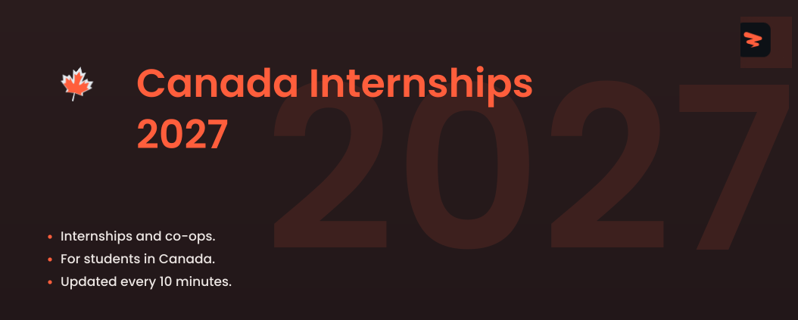

<!-- Cover -->

# Canada Internships 2027

🚀 Internships and co-ops across tech, business, healthcare, and more for students in Canada, sourced live and updated every 10 minutes.

  
  
  
  

---

## **Website & Autofill Extension**

Explore Zapply's website and check out:

- Our Chrome extension, which autofills job applications in seconds.
- A dedicated job board featuring the latest openings across various roles.
- User accounts with multiple profiles for different resume types and roles.
- Job application tracking with streaks and commitment awards.

Experience an advanced career journey with us! 🚀

  

## Explore Around

Connect and seek advice from a growing network of fellow students and new grads.

  
  &nbsp;&nbsp;
  

---

 

<h3>💻 <strong>Software Engineering</strong></h3>

| Company | Role | Location | Posted | Visa | **Apply** |
|---------|------|----------|--------|------|----------|
| **Cisco** | Software Developer I (Full Time) - Canada | Ottawa Ontario Canada +1 more | 5h |  |  |
| **TD Bank** | Software Engineer I | Toronto | 1d |  |  |
| **Cisco** | Software Developer I (Full Time) - Canada | Ottawa | 1d |  |  |
| **Affirm** | Software Engineer I, Backend (Continuous Delivery) | Canada | 1d |  |  |
| **Eaton** | Intern, Power Systems Engineering (4-12 month) - Milton, ON | Milton | 1d |  |  |
| **Eaton** | Intern, Power Systems Engineering (4-12 month) - Kitchener, ON | Kitchener | 1d |  |  |
| **Amgen** | Undergraduate  Co-op Student – Software Engineer – Large Molecule Discovery - Technology | Canada - Burnaby | 3d |  |  |
| **Magnet Forensics** | Information Security Analyst Co-op (Winter 2027) | Waterloo / Ottawa / Ontario | 3d |  |  |
| **Hitachi** | DevOps Analyst Intern | Toronto | 3d |  |  |
| **TD Bank** | Software Engineer I (Cobol Developer) | Toronto | 4d |  |  |
| **Altera** | Software Engineer -  Intern | Toronto | 4d |  |  |
| **BMO** | Software Developer (New or Recent Graduate) | Toronto, ON | 4d |  |  |
| **Cisco** | Software Developer Full Stack / Backend I (Co-op) - Canada | Kanata Ontario Canada +7 more | 1w |  |  |
| **TD Bank** | Mobile Software Engineer I (iOS) | Toronto | 1w |  |  |
| **Teledyne** | Software Engineering Coop | Canada - Waterloo, ON | 1w |  |  |
| **Qualcomm** | FY27 Intern - Telemetry Firmware, Driver and Tools Developer Internship - Canada (16 months) | Markham | 1w |  |  |
| **Arlo** | Firmware Developer Co-op | Richmond, BC | 1w |  |  |
| **Qualcomm** | FY27 Intern - AI Software Engineering Co-op  - Canada (4 months) | Toronto | 1w |  |  |
| **Google** | Software Developer II, Early Career | Canada | Date unknown |  |  |
| **Altera** | Software Engineer - Factory Apps - Intern | Toronto | 2w |  |  |
| **Aptiv** | Cloud Engineering Intern | CAN Kanata (2), ON | 2w |  |  |
| **Xsolla** | Junior Frontend Developer, Custom Webshop Development | Montreal | 2w |  |  |
| **Motorola Solutions** | Localization and QA Automation Developer Co-Op | Vancouver | 2w |  |  |
| **Google** | Software Developer Intern, PhD, Summer 2027 | Canada | Date unknown |  |  |
| **Nokia** | Network Systems Engineer Co-op/Intern | Canada | 3w | ✅ Sponsor |  |
| **Rivian and Volkswagen Group Technologies** | Software Engineering Intern - Vehicle Controls (Summer 2027) | Vancouver, BC | 3w |  |  |
| **Rivian and Volkswagen Group Technologies** | Software Engineering Intern - Embedded Platforms (Summer 2027) | Vancouver, BC | 3w |  |  |
| **Rivian and Volkswagen Group Technologies** | Software Engineering Intern - Connected Systems (Summer 2027) | Vancouver, BC | 3w |  |  |
| **Aptiv** | Cloud Software Engineer Intern | CAN Kanata (2), ON | 3w |  |  |
| **Aptiv** | Cloud Engineer Intern | CAN Kanata (2), ON | 3w |  |  |
| **Texas Instruments** | Software Engineering Intern (Canada) | Canada | 3w |  |  |
| **Qualcomm** | FY27 Intern - Display Systems Engineering Internship - Canada (16 months) | Markham | 3w |  |  |
| **Geotab** | Vehicle Systems Engineering | Waterloo | 3w |  |  |
| **CIBC** | Application/Software Developer Co-op (Winter 2027), Capital Markets Technology | Toronto, ON | 3w |  |  |
| **CIBC** | Application/Software Developer Co-op (Winter 2027), Enterprise Technology & Business Management | Toronto, ON | 3w |  |  |
| **BMO** | Junior Cloud Engineer, Summer 2027 (Co-op/Internship) - 16 months | Toronto, ON | 3w |  |  |
| **Nokia** | Embedded C/C++ SW Developer Co-op/Intern | Canada | 1mo | ✅ Sponsor |  |
| **Lumentum** | Embedded Software Engineer Co-op/Intern | Canada - Ottawa | 1mo |  |  |
| **Lumentum** | Embedded Software Developer Co-op (Optical Circuit Switch) | Canada - Ottawa | 1mo |  |  |
| **Pinterest** | Software Engineering Intern 2027 (Toronto) | Toronto, ON | 1mo |  |  |
| **PolicyMe** | Junior Software Engineer (Remote) | Remote | 1mo | ✅ Sponsor |  |
| **RTX** | Stage - Hiver 2027 - Soutien aux equipes HEP (hybrid-electric propulsion) Soutien aux... | Qc, CA | 1mo |  |  |
| **Lyft** | Business Systems Engineer Intern, Finance Technology (Summer 2027) | Toronto | 1mo |  |  |
| **Kent Building Supplies** | Security Analyst Student - Winter 2027 | Saint John, NB | 1mo |  |  |
| **Magnet Forensics** | Software Developer Co-op (Winter 2027) | Waterloo / Ottawa / Ontario | 1mo |  |  |
| **Tower Research Capital** | Stagiaire en développement de logiciels (été 2027) / Software Developer Intern (Summer 2027) | Montreal | 1mo | ✅ Sponsor |  |
| **Lyft** | Software Engineer Intern, Machine Learning (Summer 2027 - Toronto) | Toronto | 2026-09-11 |  |  |
| **Lyft** | Software Engineer Intern, Backend (Summer 2027 - Montreal) | Montreal | 2026-09-11 |  |  |
| **Stripe** | Software Engineer, Intern (Summer) | Toronto | 2026-08-31 | ✅ Sponsor |  |
| **DRW** | Software Developer Intern | Montreal | 2026-07-13 |  |  |
| **TribalScale** | Agile Software Engineer - Co-op | Toronto, ON | 2026-06-09 |  |  |
| **Squarepoint Capital** | Intern Software Developer - Montreal - 2027 | Montreal | 2026-05-07 |  |  |
| **Cresta** | Software Engineer Intern | Toronto Canada | 2024-09-10 |  |  |
| **Databricks** | Software Engineer - New Grad (2027 Start) | Bellevue +3 more | 2023-08-04 |  |  |
| **Databricks** | Software Engineering Intern (2027) | Bellevue +3 more | 2023-08-04 |  |  |

Apply for more jobs at

<h3>⚙️ <strong>Hardware & Systems</strong></h3>

| Company | Role | Location | Posted | Visa | **Apply** |
|---------|------|----------|--------|------|----------|
| **Marvell** | Data Center Silicon Hardware Engineering Intern - BS - 2027 Co-Op | Ottawa Canada +1 more | 1h |  |  |
| **Stantec** | Electrical Engineering Student – Buildings (Summer 2027) - 4-12 Term | Yellowknife, NT | 1d | ✅ Sponsor |  |
| **TD Bank** | Data Scientist I (Quants) – Insurance Model Validation | Toronto | 3d |  |  |
| **Ecolab** | Electrical Engineering Co-Op | Calgary | 3d |  |  |
| **Altera** | FPGA Design Verification Intern | Toronto | 4d |  |  |
| **Stantec** | Electrical Engineering Co-op Student - Winter 2027 | St. John's, NL | 4d | ✅ Sponsor |  |
| **Intel** | Graphics Hardware Validation Undergraduate Engineering Intern | Canada | 1w |  |  |
| **Qualcomm** | FY27 Intern - Software Validation Engineering Internship - Canada (16 months) | Markham | 1w |  |  |
| **Arlo** | Hardware Engineer Co-op | Richmond, BC | 1w |  |  |
| **Qualcomm** | FY27 Intern - Display IP FPGA Emulation Intern - Canada (4 months) | Markham | 1w |  |  |
| **Altera** | FPGA Development Tools - Intern | Toronto | 2w |  |  |
| **NVIDIA** | ASIC Verification Intern - Summer 2027 | Canada | 2w |  |  |
| **Qualcomm** | FY27 Intern - Camera HW ASIC Verification Intern - Canada (12 or 16 months) | Vancouver | 2w |  |  |
| **Marvell** | IC Validation Engineer Intern - BS/MS - 2027 Co-Op | Ottawa | 1mo |  |  |
| **Semtech** | Validation Engineering Intern | CAN - Ottawa, ON | 1mo |  |  |
| **Stantec** | Electrical Engineering Intern – Buildings (Winter 2027) - 8 Month Term | Edmonton, AB | 1mo | ✅ Sponsor |  |
| **Lumentum** | Electrical Engineer Co-op/Intern | Canada - Ottawa | 1mo |  |  |
| **Danaher** | Hardware Engineering Co-op | Concord | 1mo |  |  |
| **Hitachi** | Electrical Component Engineering Intern (Summer 2027, 16months) | Toronto | 1mo |  |  |
| **Hitachi** | Hardware Test Engineering Intern (Summer 2027, 16months) | Toronto | 1mo |  |  |
| **Thermo Fisher Scientific** | Validation Engineering Co-op | Mississauga | 1mo |  |  |
| **Hitachi** | Electrical Component Engineering Intern (Fall 2026 or Winter 2027) | Toronto | 1mo |  |  |
| **Rocket Lab** | Electrical Engineering Intern Summer 2027 | Toronto | 2026-09-09 |  |  |
| **Kent Building Supplies** | Electrical Engineering Student - Pulp & Paper Division - Winter 2027 | Saint John, NB | 2026-09-08 |  |  |

Apply for more jobs at

<h3>🔬 <strong>Data Science & Analytics</strong></h3>

| Company | Role | Location | Posted | Visa | **Apply** |
|---------|------|----------|--------|------|----------|
| **TD Bank** | Actuarial Analyst I | Toronto | 4d |  |  |
| **TD Bank** | Actuarial Analyst I - Capital | Toronto | 4d |  |  |
| **TD Bank** | Actuarial Analyst I - Project Development & Optimization | Toronto | 1w |  |  |
| **Qualcomm** | FY27 Intern - Machine Learning Engineering Internship - Canada (4 months) | Markham | 1w |  |  |
| **Stripe** | PhD Machine Learning Engineer, Intern | Toronto | 2w | ✅ Sponsor |  |
| **Stripe** | Master's Machine Learning Engineer, Intern | Toronto | 2w | ✅ Sponsor |  |
| **Manulife** | Operations & Data Analyst Co-op (8 Months) | Waterloo Ontario +1 more | 2w |  |  |
| **CIBC** | Data Analyst co-op | Toronto, ON | 2w |  |  |
| **Kent Building Supplies** | Data Analyst Student – Winter 2027 | Saint John, NB | 2w |  |  |
| **Qualcomm** | FY27 Intern - Machine Learning AISW Internship - Canada (4 Months) | Markham | 2w |  |  |
| **CIBC** | Machine Learning Engineer Co-op | Toronto, ON | 3w |  |  |
| **Lumentum** | Optical Algorithms and Analytics Engineering Co-op/Intern | Canada - Ottawa | 3w |  |  |
| **Tower Research Capital** | Machine Learning Intern | Montreal | 4w | ✅ Sponsor |  |
| **Microsoft** | Stagiaire en recherche - apprentissage automatique; Research Intern - Machine Learning | Montreal, QC | 1mo |  |  |
| **Kent Building Supplies** | Data Scientist Student – Winter 2027 | Saint John, NB | 1mo |  |  |
| **Pinterest** | Machine Learning Intern 2027 (Toronto) | Toronto, ON | 1mo |  |  |
| **Stripe** | Data Analyst, Intern | Toronto | 1mo | ✅ Sponsor |  |
| **Qualcomm** | FY27 Intern - Machine Learning Compiler & Performance Engineering Intern - Canada (16 months) | Markham | 1mo |  |  |
| **DRW** | Junior Data Analyst | Montreal | 2026-08-13 |  |  |
| **Epic Games** | Machine Learning Intern | Montreal, QC | 2026-08-07 |  |  |
| **Waabi** | 2027 Intern, PhD Research Scientist | Toronto, ON | 2025-12-18 |  |  |
| **Cresta** | Machine Learning Engineering Intern | Toronto | 2024-09-11 |  |  |

Apply for more jobs at

<h3>🤖 <strong>AI / ML</strong></h3>

| Company | Role | Location | Posted | Visa | **Apply** |
|---------|------|----------|--------|------|----------|
| **TD Bank** | Quality Engineer I (Core-Java & Mainframe) | Toronto | 1w |  |  |
| **Teledyne** | Stagiaire en tests thermiques/ Thermal Test Co-op | Canada - Montreal, QC | 1w |  |  |
| **Intel** | GPU & AI Accelerator Hardware Design Undergraduate Intern | Canada | 1w |  |  |
| **Qualcomm** | FY27 Intern - AI Software Systems Co-op - Canada (4 months) | Toronto | 1w |  |  |
| **NVIDIA** | PhD Research Intern, Quantum and AI for Chemistry - 2027 | Canada | 2w |  |  |
| **Qualcomm** | FY27 Intern - Deep Learning Research Internship - Embodied AI - Canada (4 Months) | Markham | 2w |  |  |
| **HPE** | Software Development Intern, AI-Assisted Development (Winter 2027)  /  Stagiaire en... | St. Laurent | 3w |  |  |
| **HPE (University)** | Software Development Intern, AI-Assisted Development (Winter 2027)  /  Stagiaire en... | St. Laurent | 3w |  |  |
| **Qualcomm** | FY27 Intern - Applied AI Engineering Intern (Hardware Systems) - Canada (16 months) | Vancouver | 3w |  |  |
| **Hitachi** | AI Intern, Supply Chain (Winter 2027, 12months) | Toronto | 3w |  |  |
| **Hitachi** | Stagiaire en Génie Manufacturier/Manufacturing Engineering Intern | Varennes | 1mo |  |  |
| **Amazon Development Centre Canada ULC - K03** | ML Systems Software Development Engineer Intern, Annapurna Labs - 2027 | Toronto, ON | 2026-09-11 |  |  |
| **ShyftLabs** | AI Engineer Intern | Toronto | 2026-07-21 |  |  |
| **Cresta** | Forward Deployed Engineering Intern (AI Agent) | Toronto | 2026-02-03 |  |  |

Apply for more jobs at

<h3>🛠️ <strong>Operations & Support</strong></h3>

| Company | Role | Location | Posted | Visa | **Apply** |
|---------|------|----------|--------|------|----------|
| **Vertiv** | Field Service Representative I - Thermal | Edmonton, AB | 2d |  |  |
| **Vertiv** | Field Service Representative I - Thermal | Regina, SK | 1w |  |  |
| **RTX** | Stage - Hiver 2027- Support à l’ingénierie du développement / Internship - Winter 2027 -... | Qc, CA | 3w |  |  |
| **Eaton** | Intern, Field Service Representative (4 to 12-month) - Dartmouth, NS | Dartmouth | 1mo |  |  |

Apply for more jobs at

---

### Live Job Boards

  
  &nbsp;&nbsp;
  
  &nbsp;&nbsp;
  

  
  &nbsp;&nbsp;
  
  &nbsp;&nbsp;
  

  
  &nbsp;&nbsp;
  
  &nbsp;&nbsp;
  

  
  &nbsp;&nbsp;
  

### Curated Internships

  
  &nbsp;&nbsp;
  
  &nbsp;&nbsp;
  

  

### Career Resources

  
  &nbsp;&nbsp;
  

---

Add new jobs to our listings keeping in mind the following:

- Located in Canada.
- Create a new issue to submit different job positions.
- Update a job by submitting an issue with the job URL and required changes.

Our team reviews within 24-48 hours and approved jobs are added to the main list!

Questions? Create a miscellaneous issue, and we'll assist! 🙏

**🎯 273 current opportunities from 70 companies**

**Found this helpful? Give it a ⭐ to support Zapply!**

*Not affiliated with any companies listed. All applications redirect to official career pages.*

---

## Data & Reuse

Job listings are public information provided by employers, who remain responsible for their accuracy. The compilation and the added data fields (skills, degree and visa estimates, tags) are by Zapply.

You may use, share, and build on this data, including for commercial purposes, as long as you:

- Link back to this repository as the source (followed link, no nofollow).
- Credit Zapply as the data source.
- Do not resubmit the listings to third-party job aggregators or feeds.
- Do not present Zapply enrichment fields as official employer statements; they are automated estimates provided as-is, without warranty.

You may use the name Zapply to attribute the data. Please do not use the Zapply logo or imply endorsement without written permission.

Questions or a different use? Open an issue. We say yes more often than not.

---

**Last Updated**: November 14, 2026

